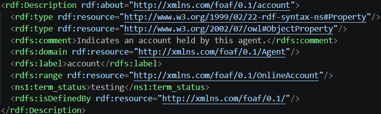
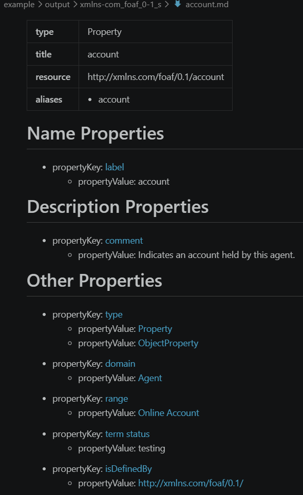
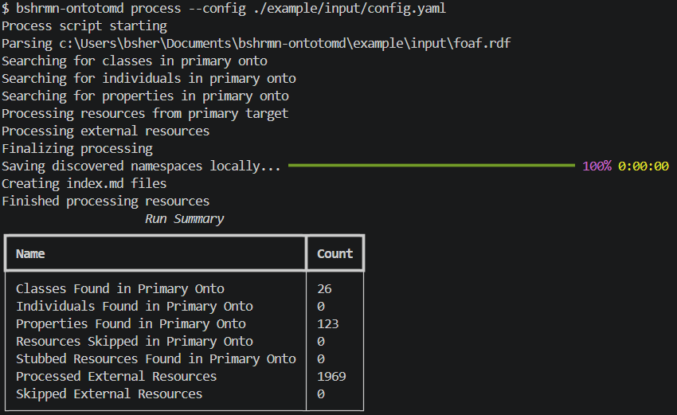

# OntoToMd
A CLI tool for parsing ontologies into directories of Markdown files by mapping their resource graphs using Markdown links between files.

(**NOTE:** This is now largely a historic personal project from Summer 2026. Updates are unlikely at this time.)

## Rationale
I have enjoyed using Obsidian for note-taking but found the process of linking parts of my notes to existing concepts that I have yet to document a bit tedious. This is especially the case for general "vocabulary" terms that I want linked so that I can see shared connections between my notes in the graph view. I thought that it would be nice to be able to jumpstart this process for a particular domain by importing a set of notes that already have appropriate connections established between them. New notes could then be inserted into this prepopulated knowledge graph by definining their connections to the existing notes. This does not eliminate the need to manually link my new notes or add new connections between existing notes as I see relevant, but it hopefully facilitates some initial setup.

## Limitations
The ontologies have rich definitions for connections that get somewhat lost when converting them to Markdown links. Thinking of them as big graphs with labeled edges between resources, the conversion process essentially removes the labels and only shows the connections. I try to mitigate this by providing context around links in the notes, but there is still a loss of information and query potential.

I am not implementing all the features of RDF or OWL at this time. The coverage of those specifications may increase in the future if I find it desirable, but the primary goal is minimal usability for my knowledge base. Features enabling reasoners are especially unlikely to have support.

## Example Usage
An example usage of this tool as applied to the FOAF ontology is included in the example folder.

The description below assumes that the package has been installed in the current Python environment (e.g. via `uv sync`) and is being called from the base folder of the project.

The tool call used is: `bshrmn-ontomd process --config ./example/input/config.yaml`

**NOTE:** The `preload` command is not used in this example but may be beneficial when more ontologies are referenced to decrease processing time of the `process` command.

The [input](/example/input) folder contains the [YAML configuration](/example/input/config.yaml) as well as the [FOAF file](/example/input/foaf.rdf) to process.

The [ontologies](/example/ontologies) folder contains the local copies of downloaded reference ontologies.

The [output](/example/output) folder contains the Markdown files, a summary of the tool call ([details.yaml](/example/output/details.yaml)), the log file ([onto-to-md.log](/example/output/onto-to-md.log)), and descriptions of folder contents (various `index.md` files).

## Future Work
I chose to focus on OWL/XML ontologies as my input, but a similar process could be used for importing other representations or even more general concept maps.

This tool was designed with Obsidian notes in mind, but it could still be useful outside of that use case. The output is primarily Markdown files so its portability should be strong minus some opinionated choices such as link style.

I was interested in aligning the output with [Open Knowledge Format (OKF v0.2)](https://github.com/GoogleCloudPlatform/open-knowledge-format/blob/main/SPEC.md) to give it some more structure and keep the door open for agential usage. Some of this is completed (YAML frontmatter in markdown resources and index pages in folders), but there is still work to be done. For example, a short one-line summary for resources included in the description key of the frontmatter and index files would be beneficial. I could not think of a universal way to do this for the XML resources, but perhaps an agent could be used to summarize resources and update the relevant files?